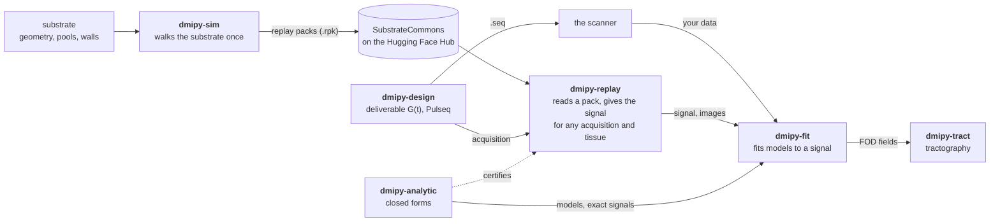

# dmipy

**Diffusion Microstructure Imaging in Python** — the revived project's **umbrella install and
documentation home**.

> One shared `G(t)` and substrate across the whole loop: **design** the sequence, **simulate** the
> substrate once, **replay** it under any acquisition, **fit** the tissue, **track** the fibres.
>
> Docs: **[dmipy.org](https://dmipy.org)** &nbsp;·&nbsp; coming from the 2019 toolbox?
> [What changed](https://dmipy.org/migrating/)

## How the packages fit together



- **[dmipy-sim](https://github.com/dmrai-lab/dmipy-sim)** walks a substrate once and stores the walk as a replay pack.
- **[dmipy-replay](https://github.com/dmrai-lab/dmipy-replay)** reads a pack and gives its signal for any acquisition
  inside the pack's envelope, with relaxation, wall contact, susceptibility and orientation set at read time.
- **[dmipy-fit](https://github.com/dmrai-lab/dmipy-fit)** fits microstructure models to a signal: replayed, closed-form,
  or measured.
- **[dmipy-analytic](https://github.com/dmrai-lab/dmipy-analytic)** holds the closed forms: the models' building
  blocks, and the exact references every replay is checked against.
- **[dmipy-design](https://github.com/dmrai-lab/dmipy-design)** designs deliverable gradient waveforms and exports
  them to Pulseq.
- **[dmipy-tract](https://github.com/dmrai-lab/dmipy-tract)** tracks fibres through the FOD fields that fit
  produces.

Each package installs the ones it builds on: dmipy-analytic (NumPy only) under dmipy-replay, dmipy-replay under
dmipy-sim, and dmipy-sim under dmipy-fit, dmipy-design and dmipy-tract.

```bash
pip install dmipy            # dmipy-sim + dmipy-replay + dmipy-fit + dmipy-design
pip install "dmipy[tract]"   # + dmipy-tract, tractography on FOD fields
pip install "dmipy[cuda12]"  # + JAX GPU
```

```python
import dmipy_sim, dmipy_replay, dmipy_fit, dmipy_design, dmipy_analytic   # no importable `dmipy`; import the packages
```

> **Upgrading from dmipy 1.x?** dmipy 3 is a meta-package with no importable `dmipy` module: you import
> `dmipy_sim`, `dmipy_replay`, `dmipy_fit` and the others directly, so `import dmipy` code from 1.x does not run.
> The 1.x line (the original 2019 toolbox, Fick–Wassermann–Deriche) stays on PyPI: `pip install "dmipy<2"`.

## This repo

- `pyproject.toml` — the thin `dmipy` meta-package (installs dmipy-sim, dmipy-replay, dmipy-fit and
  dmipy-design; the `tract` extra adds dmipy-tract).
- `docs/` + `mkdocs.yml` — the [dmipy.org](https://dmipy.org) site (MkDocs Material; built and
  deployed by `.github/workflows/docs.yml`).
- `papers/` — reproducible manuscripts (source + PDF + rerunnable figures); currently
  `papers/surface_relaxivity_bias/` — *"Surface relaxivity biases diffusion and relaxometry
  microstructure estimates."* See [`papers/README.md`](papers/README.md).

Build the docs locally:

```bash
pip install ".[docs]"
mkdocs serve
```

## License

Dual-licensed: **GNU AGPL-3.0** for open-source use, or a **commercial license** for
proprietary/closed use — the same terms apply to both engines. See [LICENSE](LICENSE) and
[LICENSING.md](LICENSING.md) (commercial: rutger.fick@dmrai-lab.org).

The lab and its philosophy: **[dmrai-lab.org](https://dmrai-lab.org)**.
