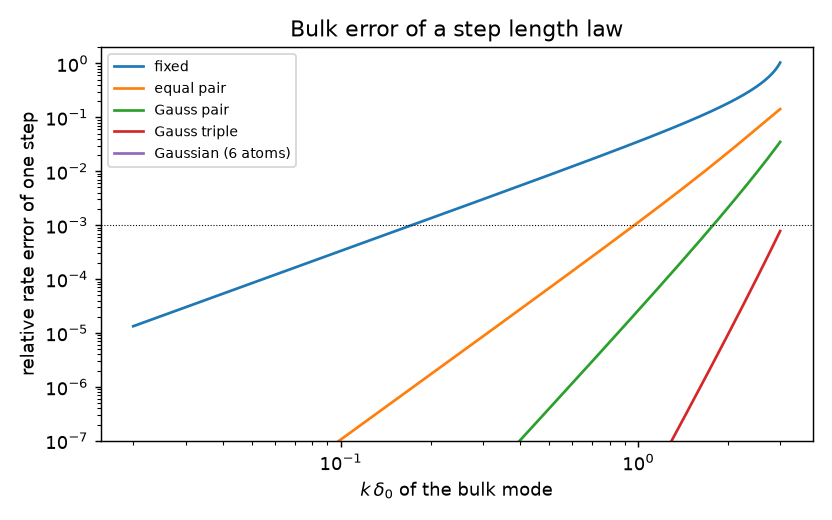
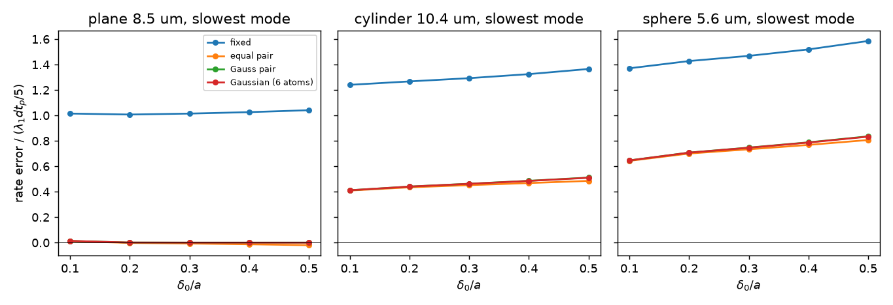
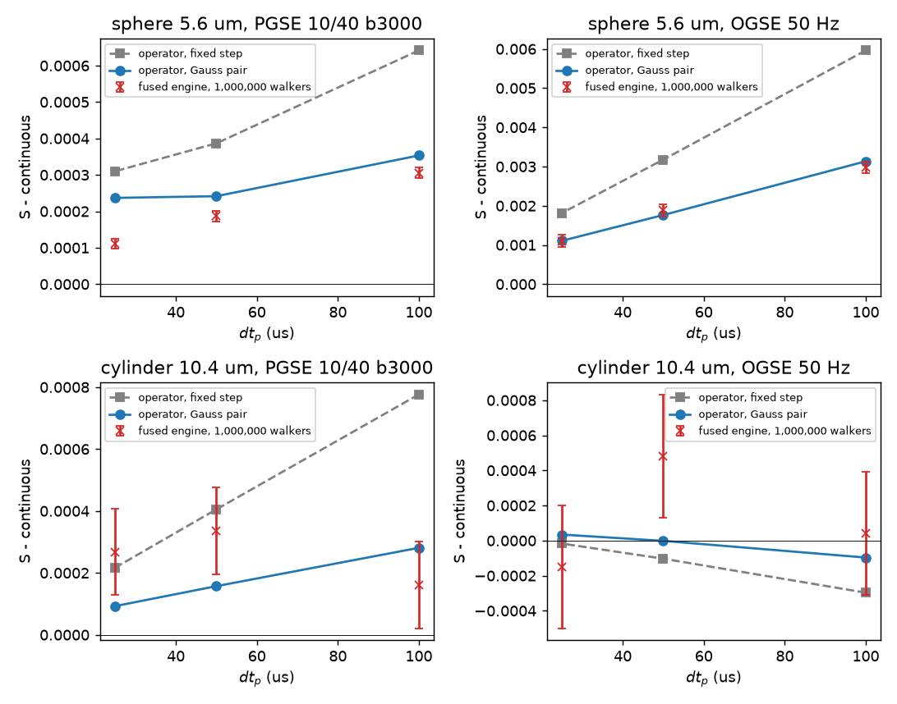
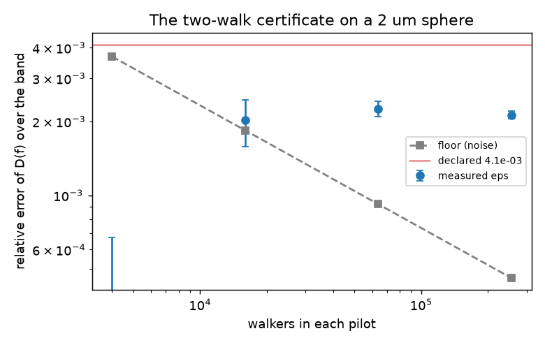

<!-- generated by tools/gen_step_law_page.py from dmrai-lab/dmipy-sim@bc0e2e931de8 docs/step-law.md; regenerate it there with tools/gen_step_law.py -->
# The step law, shown

Built from `dmipy-sim@5719020` on 2026-10-16 at tier `full` on NVIDIA GH200 480GB; the script is `tools/gen_step_law.py` in dmipy-sim, the numbers it measured are in `step-law/step_law.json`. Every value on this page is one of those measurements.

The walk's step is the **Gauss pair**: an isotropic direction times `sqrt(6 D dt_p)` times one of two lengths, so that the step's second, fourth and sixth moments are the Gaussian step's. The physics step `dt_p` is what holds the walk's diffusion spectrum within a declared tolerance `eps_D` up to the acquisition's band, and the build's pilot measures that error from two walks and records it. This page is the evidence; the invariants are in `tests/math/test_step_law.py`, `tests/test_step_rule.py` and `tests/math/test_step_certificate.py`.

## 1. The laws

A step of length `delta` multiplies a bulk mode `k` by `sinc(k delta)`; averaged over the Gaussian step's length law (`|r|^2 / 2 D dt ~ chi^2_3`) that is `exp(-D k^2 dt)` exactly. A fixed length has a fourth moment of 36 against the Gaussian's 60 (in `D^2 dt^2`), and that shortfall is the whole first-order rate error `lambda dt_p / 5`. The n-point Gauss-Laguerre quadrature of the chi^2_3 law matches `2n - 1` moments; the pair matches three. Moments are in units of the Gaussian step's; `reach` is the largest `k delta_0` whose rate error stays within the tolerance.

| law | lengths / delta_0 | weights | E[d^2] | E[d^4] | E[d^6] | longest | reach at 1e-3 | reach at 1e-4 |
|---|---|---|---|---|---|---|---|---|
| fixed | 1.000 | 1.000 | 1.000 | 0.600 | 0.257 | 1.00 | 0.17 | 0.05 |
| equal pair | 0.428, 1.348 | 0.500, 0.500 | 1.000 | 1.000 | 0.771 | 1.35 | 0.97 | 0.55 |
| Gauss pair | 0.783, 1.649 | 0.816, 0.184 | 1.000 | 1.000 | 1.000 | 1.65 | 1.79 | 1.24 |
| Gauss triple | 0.666, 1.366, 2.165 | 0.640, 0.345, 0.015 | 1.000 | 1.000 | 1.000 | 2.17 | 3.00 | 2.50 |
| Gaussian (6 atoms) | 0.495, 0.996, 1.513, 2.057, 2.651, 3.349 | 0.349, 0.471, 0.162, 0.017, 0.000, 0.000 | 1.000 | 1.000 | 1.000 | 3.35 | 3.00 | 3.00 |

The engine's `pair_step` over 200,000 draws: E[d^2] 0.9967, E[d^4] 0.9935, E[d^6] 0.9921, longest step 1.6495 delta_0, long-step frequency 0.1822 (the law's 0.18377), lengths drawn 0.7827, 1.6495.

## 2. The operator on the three pores, and the envelope on a packing

The one-step operator of the engine's own `reflect`, projected on the pore's eigenmodes by quadrature (`dmipy_sim.math.step_law.SteppedPore`). Each entry is the rate error of the pore's slowest mode under one step, in units of `lambda_1 dt_p / 5`, against the step `delta_0 / a` (`a` the radius or the slab's half width). A value that stays constant as the step shrinks is a first-order term; the matched laws share it, and it is zero on a flat wall.

**plane 8.5 um**, slowest mode of rate 273 /s:

| law | delta_0/a = 0.1 | delta_0/a = 0.2 | delta_0/a = 0.3 | delta_0/a = 0.4 | delta_0/a = 0.5 |
|---|---|---|---|---|---|
| fixed | +1.01 | +1.01 | +1.01 | +1.03 | +1.04 |
| equal pair | +0.01 | -0.00 | -0.01 | -0.01 | -0.02 |
| Gauss pair | +0.01 | +0.00 | +0.00 | +0.00 | +0.00 |
| Gauss triple | +0.01 | +0.00 | +0.00 | +0.00 | +0.00 |
| Gaussian (6 atoms) | +0.01 | +0.00 | +0.00 | +0.00 | +0.00 |

**cylinder 10.4 um**, slowest mode of rate 251 /s:

| law | delta_0/a = 0.1 | delta_0/a = 0.2 | delta_0/a = 0.3 | delta_0/a = 0.4 | delta_0/a = 0.5 |
|---|---|---|---|---|---|
| fixed | +1.24 | +1.27 | +1.29 | +1.32 | +1.37 |
| equal pair | +0.41 | +0.43 | +0.45 | +0.47 | +0.49 |
| Gauss pair | +0.41 | +0.44 | +0.46 | +0.49 | +0.51 |
| Gauss triple | +0.41 | +0.44 | +0.46 | +0.49 | +0.51 |
| Gaussian (6 atoms) | +0.41 | +0.44 | +0.46 | +0.49 | +0.51 |

**sphere 5.6 um**, slowest mode of rate 1105 /s:

| law | delta_0/a = 0.1 | delta_0/a = 0.2 | delta_0/a = 0.3 | delta_0/a = 0.4 | delta_0/a = 0.5 |
|---|---|---|---|---|---|
| fixed | +1.37 | +1.43 | +1.47 | +1.52 | +1.59 |
| equal pair | +0.64 | +0.70 | +0.73 | +0.77 | +0.81 |
| Gauss pair | +0.65 | +0.71 | +0.75 | +0.79 | +0.84 |
| Gauss triple | +0.65 | +0.71 | +0.75 | +0.79 | +0.83 |
| Gaussian (6 atoms) | +0.65 | +0.71 | +0.75 | +0.79 | +0.83 |

A geometry that declares no pore (a packing, a mesh) takes the envelope: a sphere of its smallest feature with the sphere's coefficient. On a packing of 2.5 um spheres the two-walk certificate measures each pool's real error at the step the envelope sizes; the extracellular pool sees the concave side of every wall, which the sphere's coefficient does not describe, so the measurement is what certifies it:

| pool | walkers | fine / coarse sub-steps | declared eps | measured eps | se | floor | resolves |
|---|---|---|---|---|---|---|---|
| intra | 256,000 | 24 / 6 | 1.0e-03 | 4.54e-04 | 1.3e-04 | 5.4e-04 | yes |
| extra | 256,000 | 24 / 6 | 1.0e-03 | 5.00e-04 | 1.3e-04 | 5.4e-04 | yes |

## 3. The fused engine against the operator

The operator is one step of the engine's `reflect` in float64 quadrature. The fused engine runs the whole walk in float32 with its bounce budget, nudges and sub-step loop, the gradient applied in the walk. If the two agree to the standard error, the loop adds nothing the operator does not predict. `pull` is the engine's distance from the pair operator in standard errors.

| pore, row | dt_p (us) | continuous | operator, fixed | operator, pair | engine | se | pull | walkers x seeds |
|---|---|---|---|---|---|---|---|---|
| sphere/PGSE 10/40 b3000 | 100 | 0.97938 | 0.98002 | 0.97973 | 0.97968 | 1.4e-05 | -3.5 | 1,000,000 x 4 |
| sphere/PGSE 10/40 b3000 | 50 | 0.97938 | 0.97976 | 0.97962 | 0.97956 | 1.4e-05 | -4.0 | 1,000,000 x 4 |
| sphere/PGSE 10/40 b3000 | 25 | 0.97938 | 0.97969 | 0.97961 | 0.97949 | 1.4e-05 | -9.1 | 1,000,000 x 4 |
| sphere/OGSE 50 Hz | 100 | 0.74458 | 0.75054 | 0.74771 | 0.74756 | 1.5e-04 | -1.0 | 1,000,000 x 4 |
| sphere/OGSE 50 Hz | 50 | 0.74458 | 0.74775 | 0.74634 | 0.74646 | 1.6e-04 | +0.8 | 1,000,000 x 4 |
| sphere/OGSE 50 Hz | 25 | 0.74458 | 0.74639 | 0.74568 | 0.74568 | 1.6e-04 | -0.0 | 1,000,000 x 4 |
| cylinder/PGSE 10/40 b3000 | 100 | 0.75441 | 0.75518 | 0.75469 | 0.75457 | 1.4e-04 | -0.9 | 1,000,000 x 4 |
| cylinder/PGSE 10/40 b3000 | 50 | 0.75441 | 0.75481 | 0.75456 | 0.75474 | 1.4e-04 | +1.3 | 1,000,000 x 4 |
| cylinder/PGSE 10/40 b3000 | 25 | 0.75441 | 0.75462 | 0.75450 | 0.75467 | 1.4e-04 | +1.3 | 1,000,000 x 4 |
| cylinder/OGSE 50 Hz | 100 | 0.09613 | 0.09584 | 0.09604 | 0.09617 | 3.5e-04 | +0.4 | 1,000,000 x 4 |
| cylinder/OGSE 50 Hz | 50 | 0.09613 | 0.09603 | 0.09613 | 0.09662 | 3.5e-04 | +1.4 | 1,000,000 x 4 |
| cylinder/OGSE 50 Hz | 25 | 0.09613 | 0.09612 | 0.09617 | 0.09599 | 3.5e-04 | -0.5 | 1,000,000 x 4 |

The operator's own precision is its symmetry check, the largest asymmetry of the one-step matrix over the levels above: plane 1e-05, cylinder 6e-05, sphere 9e-05. A row whose standard error is below that check reads the operator's quadrature, not the engine; a pull there is not a defect of the walk until the operator is refined past it.

## 4. The certificate's resolution

The two-walk certificate on a 2 um sphere read to 1000 Hz over 40 ms (the rule's count at `eps_D = 1e-3`: 37 sub-steps per 100 us). The statistic is the noise-corrected rms over the band's bins of the relative difference between the fine and the coarse walk's spectra; its floor is the noise it cannot see under, falling as one over the square root of walkers times bins. A pilot resolves a tolerance when its floor is under it; the record says so.

| walkers | fine / coarse | declared | measured | se | floor | resolves | seconds |
|---|---|---|---|---|---|---|---|
| 4,000 | 9 / 2 | 4.1e-03 | 0.00e+00 | 6.7e-04 | 3.7e-03 | yes | 3 |
| 16,000 | 9 / 2 | 4.1e-03 | 2.02e-03 | 4.4e-04 | 1.8e-03 | yes | 4 |
| 64,000 | 9 / 2 | 4.1e-03 | 2.25e-03 | 1.6e-04 | 9.2e-04 | yes | 9 |
| 256,000 | 9 / 2 | 4.1e-03 | 2.13e-03 | 7.5e-05 | 4.6e-04 | yes | 16 |
| 256,000 | 37 / 9 | 1.0e-03 | 2.10e-04 | 1.1e-04 | 5.2e-04 | yes | 38 |

## 5. The cost

Sub-steps per 100 us sample that each rule asks for at `eps_D = 1e-3` and a 200 Hz band, the rule that binds, and the walk's throughput on this device. `R/6` is the retired reflection rule (`delta_0 = min_feature / 6`), shown for the pores it applied to. On a mesh the collision lookup bounds the LONGEST step by the cell: `fixed` is that count for a fixed step, `atom` for the pair's long atom, the price of the bounded law where this rule binds.

| substrate | step law | regime | lookup (fixed -> atom) | crossing | binds | sub-steps | R/6 | walker-steps / s | walkers |
|---|---|---|---|---|---|---|---|---|---|
| sphere 2 um | 148 | 5 | - | 1 | step law | 148 | 44 | 1.45e+08 | 100,000 |
| cylinder 20 um | 1 | 1 | - | 1 | step law | 1 | 1 | 7.81e+06 | 100,000 |
| plane 8.5 um | 1 | 1 | - | 1 | step law | 1 | 1 | 9.35e+06 | 100,000 |
| packed spheres 2.5 um (both pools) | 24 | 1 | - | 1 | step law | 24 | 7 | 3.02e+07 | 100,000 |
| icosphere mesh 4 um | 2 | 1 | 1 -> 2 | 1 | step law | 2 | 3 | 6.49e+05 | 100,000 |
| mesh 100_100_dsp_10_alpha_1.5_beta_0.5_target | 145 | 1 | 53 -> 145 | 1 | step law | 145 | 43 | not walked: init_positions cannot seed this OPEN surface: 5057 boundary edge(s), and no periodic axis closes them by ident | - |

## 6. What the certificate does not see

The walk accrues each sub-step's phase from the position at the step's end, a rectangle rule for the integral of `G . x`. On the slab the operator separates the two remaining terms: the step law's dispersion (third order under the pair, and zero at first order on a flat wall) and the phase rule's, whose error falls as the square of the step (the increment within a step has zero mean, so the rule's first-order term averages out and its variance is what remains). The certificate reads trajectories, so it measures the first and not the second; the phase rule is a kernel matter of its own.

| row, plane 8.5 um | dt_p (us) | total error | dispersion (pair) | phase rule |
|---|---|---|---|---|
| PGSE 10/40 b3000 | 100 | -2.6e-05 | -8.2e-06 | -2.6e-05 |
| PGSE 10/40 b3000 | 25 | -8.4e-07 | +2.7e-07 | -1.6e-06 |
| OGSE 50 Hz | 100 | -7.0e-05 | +3.0e-06 | -7.0e-05 |
| OGSE 50 Hz | 25 | -4.6e-06 | -3.9e-08 | -4.4e-06 |

The CUDA backend's kernels take the same two atoms and weight from the request and are admitted against this operator (dmrai-lab/dmipy-sim-cuda#60).
