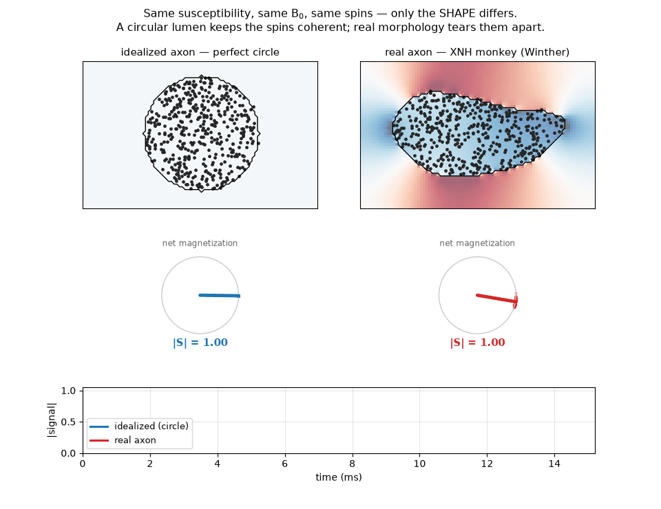
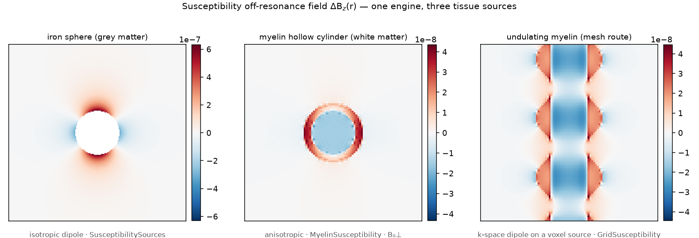
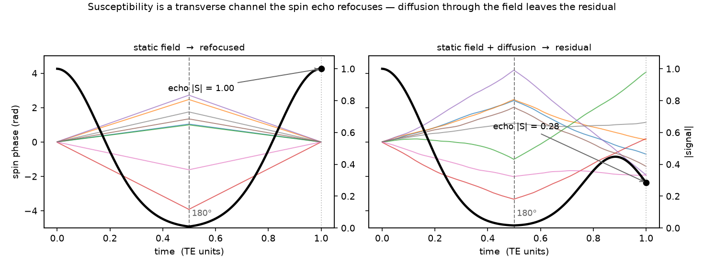

# Susceptibility

Myelin, iron and deoxyhaemoglobin perturb the local field. Each source gives an off-resonance
field ΔB_z(r); a diffusing spin accrues the extra phase γ ∫ ΔB_z(r(t)) dt on top of the gradient
phase, read through the same substrate as diffusion, relaxation and exchange.

{ width="100%" }

Inside a circular lumen the internal field is uniform, so every spin precesses together and the
signal only rotates. Inside a real, non-circular lumen the field varies, the spins fan out and the
signal collapses: susceptibility-induced dephasing reads out the morphology (Winther 2024).

## Where the field comes from

A substrate's field is its magnetic pools' own: a pool of the spec that carries a `susceptibility` is a field
source, and the walk computes the field basis of the sources and reads it along every walker's path. The basis is
linear in χ and B₀, so the pack stores it once and a replay multiplies it by the tissue's susceptibility and the
scanner's field. The basis comes by one of two routes:

- **The myelin sheath in closed form**: the hollow cylinder of isotropic and anisotropic susceptibility (Wharton &
  Bowtell 2012), infinite or as finite segments of a swept strand (`dmipy_analytic.fields`); the intra-axonal
  offset ½ Δχ_A B₀ sin²θ ln(1/g) is uniform inside the lumen and zero when B₀ is along the fibre.
- **Any shape on a grid**: the distribution of susceptibility rasterised on the domain grid and solved by the
  Lorentz-corrected k-space dipole model (Salomir 2003; Marques & Bowtell 2005; `dmipy_sim.dipole_field`). The
  route for real morphology: a segmented axon, an undulating sheath, a mesh, a sphere union.

{ width="100%" }

The field precesses the spin at its current position, so it composes with every other effect in
one pass, and the sequence's own 180 refocuses its *static* part exactly as in a real spin echo:
only the diffusion-driven residual survives, the part that carries microstructure.

{ width="80%" }

A myelinated axon's sheath is a field source: its pool is magnetic, so the walk reads the field along every
walker's path and the pack stores it as a channel. The susceptibility and the scanner's field are replay knobs, and
the fibre's angle to B0 is the pose:

```python
import numpy as np
import dmipy_sim as ds
from dmipy_replay import Envelope, Tissue, sequences

axon = ds.MyelinatedCylinder(inner_radius=2e-6, outer_radius=3e-6, orientation=(0, 0, 1),
                             compartments=ds.Compartments(extra=ds.Pool(D=1.7e-9), intra=ds.Pool(D=1.7e-9),
                                                          myelin=ds.Pool(D=0.0)))
env = Envelope(name="docs", band_hz=400.0, G_max=0.08, B0_list=(3.0, 7.0), chi_max=2e-7, rho2_max=None,
               max_refocusing_pulses=1)                     # the field tier certified to 7 T and |chi| 2e-7
pack = ds.build_replay_pack(ds.walk(axon.spec, 500, T_max=0.04, envelope=env, seed=0, require_gpu=False),
                            id="docs/myelinated-axon", license="CC-BY-4.0", citation="dmipy.org")
myelin = Tissue(chi_iso=-0.1e-6, chi_aniso=-0.1e-6)         # the sheath's susceptibility: a replay knob
se = sequences.pgse([[0, 0, 1]], 0.005, 0.020, gradient_strengths=[0.0], TE=0.040)   # a bare spin echo
ge = sequences.gre(0.040)                                                       # a bare gradient echo
for B0 in (3.0, 7.0):
    for axis in ((0, 0, 1), (1, 0, 0)):                      # the fibre along B0, then across it
        S = [float(np.abs(pack.replay(s, tissue=myelin, scanner=B0, orientation=axis)[0])) for s in (se, ge)]
        print(B0, axis, np.round(S, 4))                      # across B0 the field dephases; the 180 refocuses its static part
```

In the [coherence-gating](coherence_gating.md) law susceptibility is the purely transverse R₂′
term: longitudinal storage pauses it over the mixing time. The field solver is validated against
the exact sphere and cylinder fields, the hollow-cylinder intra-axonal law, and Winther et al.
2024's Monte Carlo on segmented monkey axons.
